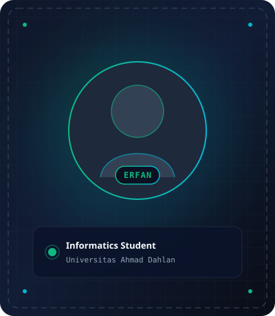

# 🌐 Personal Portfolio & Academic Archive — Erfannindya Ade Noventyas (Informatika UAD)

Website portofolio pribadi modern dan arsip akademik mingguan untuk **Erfannindya Ade Noventyas (Erfan)**, mahasiswa Informatika **Universitas Ahmad Dahlan (UAD)** (NIM: `2300018279`). Dirancang dengan konsep *Modern Developer Portfolio + Subtle Cybersecurity Aesthetic*, ringan, responsif, dan siap dipublikasikan secara gratis melalui **GitHub Pages**.

---

## 📁 Struktur Berkas Proyek

```text
Web/
│
├── index.html                  # Halaman utama (Public Portfolio)
├── 404.html                    # Halaman penanganan rute tidak ditemukan
├── .nojekyll                   # Menjamin GitHub Pages memproses seluruh berkas statis
├── README.md                   # Dokumentasi lengkap & panduan deployment
│
├── academic/
│   └── index.html              # Halaman khusus arsip tugas kuliah mingguan untuk dosen
│
├── css/
│   ├── style.css               # Gaya visual & responsivitas Public Portfolio
│   └── academic.css            # Gaya visual & dashboard Academic Archive
│
├── js/
│   ├── script.js               # Logika interaktif portfolio (navbar, copy email, scroll spy)
│   ├── assignments.js          # Pusat data tugas mingguan (mudah diedit tanpa ubah HTML)
│   └── academic.js             # Logika filter, pencarian, sort, dan kalkulasi dashboard tugas
│
└── assets/
    ├── icons/
    │   └── favicon.svg         # Monogram logo EA dalam format SVG vektor
    ├── images/
    │   ├── profile-placeholder.svg # Ilustrasi placeholder foto profil
    │   └── mt5-project.svg     # Ilustrasi teknis proyek MQL5 Expert Advisor
    └── documents/              # Folder opsional untuk dokumen lokal jika dibutuhkan
```

---

## 🚀 Fitur Unggulan

### 1. Public Portfolio (`index.html`)
- **Visual Identity:** Dark theme (navy/black `#070a13`), aksen *emerald green* (`#10b981`) dan *cyan* (`#06b6d4`), estetika keamanan siber & developer minimalis.
- **Hero Section:** Headline resmi Informatika UAD, terminal bash simulasi, tombol aksi, serta slot foto profil yang mudah diganti.
- **About Me:** Deskripsi orisinal sesuai minat akademik, kartu identitas mahasiswa (NIM, UAD, Yogyakarta, orientasi karier).
- **Categorized Skills:**
  - *Programming Languages:* **MQL5** (highlight khusus automated trading MetaTrader 5), HTML, CSS, JavaScript, PHP.
  - *Cybersecurity & Systems:* Cybersecurity Fundamentals, Basic Pentesting, Network Security, PC Assembly & OS Troubleshooting.
- **Featured Projects:** Menampilkan *MT5 Expert Advisor* dengan rincian arsitektur teknis, indikator logika, manajemen risiko, serta slot *Coming Soon* yang elegan.
- **Learning Interests:** Menunjukkan eksplorasi aktif di bidang keamanan siber, MQL5 trading, hardware, dan web.
- **Real Contact:** Tombol *Copy Email* otomatis dengan toast notifikasi, link mailto langsung, serta tautan profil GitHub & LinkedIn.
- **Aksesibilitas & Navigasi:** Sticky navbar, smooth scrolling, active section highlight, hamburger menu di smartphone, serta tombol *Back to Top*.

### 2. Coursework Repository (`academic/index.html`)
- **Tujuan:** Direktori akademik profesional berbahasa Inggris untuk dosen dan evaluator yang terhubung langsung ke Google Drive.
- **Folder Template:** Struktur folder bergaya modern (`Research-Methodology-Sem7/`) dengan item template tugas yang siap pakai.
- **Google Drive Direct Redirect:** Tombol *Open in Google Drive* langsung mengarahkan dosen ke berkas atau folder Google Drive Anda.
- **Bisa Dibuka Langsung (Offline/Online):** Tautan header mengarah ke `academic/index.html`, sehingga dapat diklik langsung baik saat membuka file secara lokal (`file:///`) maupun setelah hosting di GitHub Pages tanpa memicu tampilan indeks folder server.

---

## ✏️ Panduan Mengganti Data Pribadi (Placeholder)

Sebelum mempublikasikan website, buka berkas berikut dan ganti teks placeholder dengan data Anda:

### 1. Di dalam `index.html`:
- Ganti `[NAMA LENGKAP]` dengan nama lengkap Anda (contoh: Muhammad Erfan ...).
- Ganti `[NIM]` dengan nomor induk mahasiswa Anda di UAD.
- Ganti `[EMAIL]` dengan alamat email aktif Anda (pada teks dan atribut `href="mailto:..."`).
- Ganti `[LINK GITHUB]` dengan URL profil GitHub Anda (contoh: `https://github.com/erfanxyz`).
- Ganti `[LINK LINKEDIN JIKA ADA]` dengan URL profil LinkedIn Anda.
- **Mengganti Foto Profil:** Masukkan foto Anda ke folder `assets/images/profile.jpg`, kemudian pada `index.html` baris hero section, ganti:
  ```html
  
  ```
  menjadi:
  ```html
  
  ```

### 2. Di dalam `academic/index.html`:
- Ganti `[NAMA LENGKAP]` dan `[NIM]` pada kartu identitas mahasiswa (*Student Bio Card*).

---

## 📝 Panduan Menambahkan / Mengedit Tugas Mingguan

Anda **tidak perlu mengubah kode HTML** setiap kali ada tugas baru. Cukup edit berkas `js/assignments.js`:

1. Buka berkas `js/assignments.js`.
2. Unggah file tugas Anda ke **Google Drive**.
3. Pastikan hak akses file/folder di Google Drive disetel ke:
   > *"Siapa saja yang memiliki tautan dapat melihat" (Anyone with the link can view)*.
4. Salin link Google Drive tersebut.
5. Tambahkan data tugas baru ke dalam array `assignmentsData`:

```javascript
{
  id: 7,                                            // Nomor unik berikutnya
  semester: "7",                                    // Semester saat ini
  subject: "Keamanan Jaringan & Sistem",           // Nama mata kuliah
  meeting: 4,                                       // Pertemuan ke-
  title: "Analisis Log Firewall & Mitigasi Serangan", // Judul tugas
  description: "Laporan analisis log serangan brute-force SSH dan konfigurasi fail2ban.",
  assignedDate: "2026-11-01",                       // Tanggal diberikan (YYYY-MM-DD)
  deadline: "2026-11-08",                           // Batas waktu pengumpulan
  status: "Submitted",                              // Pilihan: "Not Started" | "In Progress" | "Submitted" | "Reviewed"
  fileUrl: "https://drive.google.com/file/d/YOUR_DRIVE_ID/view?usp=sharing"
}
```
6. Simpan berkas (`Ctrl + S`), commit dan push ke GitHub. Website akan langsung menampilkan tugas baru secara otomatis!

---

## 🌐 Panduan Lengkap Publikasi Gratis ke GitHub Pages

GitHub Pages memungkinkan Anda memiliki website online gratis dengan domain beralamat `https://USERNAME.github.io/`.

### Langkah 1: Buat Akun GitHub
1. Kunjungi [github.com](https://github.com/) dan daftar akun jika belum memiliki akun.
2. Catat username GitHub Anda (misal username Anda adalah `erfan-uad`).

### Langkah 2: Buat Repositori Khusus GitHub Pages
1. Klik tombol **New** (atau ikon **+** di pojok kanan atas -> *New repository*).
2. Beri nama repositori persis dengan format:
   ```text
   USERNAME.github.io
   ```
   *(Ganti `USERNAME` dengan username akun GitHub Anda. Contoh: `erfan-uad.github.io`)*.
3. Atur repositori menjadi **Public**.
4. Biarkan opsi "Add a README file" **tidak dicentang** (karena kita sudah memiliki README).
5. Klik **Create repository**.

### Langkah 3: Unggah Berkas Menggunakan Git CLI atau GitHub Desktop

#### Cara A: Menggunakan Git Bash / Terminal (Direkomendasikan)
Buka terminal pada folder proyek ini (`Web`) lalu jalankan perintah berikut:

```bash
# Inisialisasi git lokal
git init

# Tambahkan seluruh berkas
git add .

# Buat commit pertama
git commit -m "Initial commit: Erfan portfolio & academic archive"

# Ubah branch utama menjadi main
git branch -M main

# Hubungkan dengan remote repository GitHub Anda (ganti USERNAME)
git remote add origin https://github.com/USERNAME/USERNAME.github.io.git

# Unggah berkas ke GitHub
git push -u origin main
```

#### Cara B: Mengunggah Langsung Lewat Browser
1. Pada halaman repository GitHub yang baru dibuat, klik tautan **"uploading an existing file"**.
2. Tarik (*drag and drop*) seluruh isi folder proyek (`index.html`, `academic/`, `css/`, `js/`, `assets/`, `404.html`, `.nojekyll`, `README.md`).
3. Tulis pesan commit di bagian bawah: `Initial upload portfolio`.
4. Klik tombol **Commit changes**.

### Langkah 4: Memeriksa Pengaturan GitHub Pages
1. Masuk ke tab **Settings** di repository Anda.
2. Pada panel menu sebelah kiri, klik menu **Pages**.
3. Pastikan pada bagian **Build and deployment**:
   - Source: **Deploy from a branch**
   - Branch: **main** dan folder **/ (root)**
4. Klik **Save** jika belum tersimpan.
5. Tunggu 1–3 menit. GitHub akan membuat proses deployment secara otomatis.

### Langkah 5: Mengakses Website Anda
Website Anda kini sudah aktif dan dapat diakses di seluruh dunia:
- **Public Portfolio:** `https://USERNAME.github.io/`
- **Academic Archive (khusus tugas dosen):** `https://USERNAME.github.io/academic/`

---

## 🔄 Cara Memperbarui Website di Masa Mendatang

Setiap kali Anda menambah tugas mingguan di `js/assignments.js` atau mengubah data proyek:

```bash
git add .
git commit -m "Update tugas mingguan pertemuan X"
git push
```
GitHub Pages akan otomatis memperbarui situs web dalam 1-2 menit.

---

## ⚡ Alternatif Hosting: Netlify

Jika Anda lebih menyukai Netlify:
1. Buat akun di [netlify.com](https://www.netlify.com/).
2. Masuk ke dashboard -> Klik **Add new site** -> **Import an existing project**.
3. Pilih penyedia **GitHub**, pilih repositori `USERNAME.github.io`.
4. Build command: *(kosongkan)*.
5. Publish directory: `.` *(root)*.
6. Klik **Deploy site**. Netlify akan langsung memberikan URL aktif seperti `https://erfan-portfolio.netlify.app`.

---

## 📄 Lisensi & Hak Cipta
Dirancang dan dibangun untuk **Erfan — Mahasiswa Informatika Universitas Ahmad Dahlan**.
Bebas dikembangkan dan dimodifikasi untuk kebutuhan portofolio akademik dan profesional.
*"Designed and built with curiosity."*

